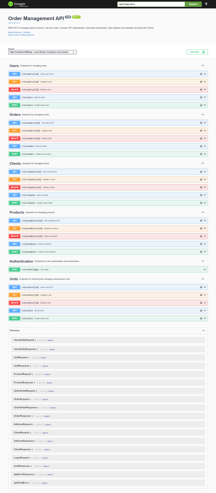
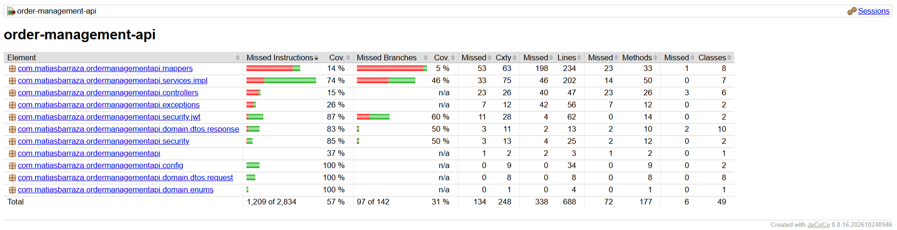
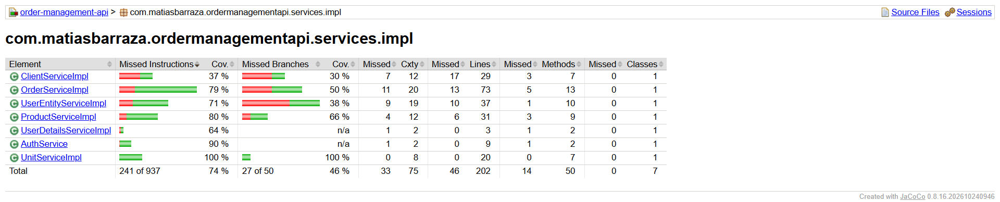

# 📦 Order Management API


**Order Management API** is a Java and Spring Boot REST API for managing clients, products, measurement units, users, and orders. It demonstrates layered backend development, JWT authentication, role-based authorization, database migrations, validation, automated testing, and containerized local execution.

This is a **portfolio/learning project** intended to be run locally with Docker Compose; it is not a fiscal invoicing platform or a publicly deployed service.

## ✨ Features

- **Order processing:** create and update orders with multiple product lines; retrieve each product's unit price from the database and calculate line subtotals and order totals on the server.
- **Catalog management:** CRUD endpoints for products and measurement units.
- **Client management:** CRUD endpoints and document uniqueness validation.
- **User management:** administrative CRUD operations, password encoding, roles, and active/inactive users.
- **Authentication and authorization:** stateless Bearer JWT authentication with Spring Security and role-based access rules.
- **API contracts:** Java record DTOs, Jakarta Bean Validation, MapStruct mappings, and consistent JSON error responses.
- **Persistence:** PostgreSQL with Spring Data JPA/Hibernate and four versioned Flyway SQL migrations, including demonstration data.
- **Developer tooling:** Swagger UI/OpenAPI, Postman collection, Docker Compose, JUnit/Mockito/Spring tests, and JaCoCo coverage reports.

## 🛠️ Tech stack

| Area | Technologies |
| --- | --- |
| Language & framework | Java 21, Spring Boot 4.1.0 |
| HTTP & validation | Spring Web MVC, Jakarta Validation |
| Persistence | Spring Data JPA, Hibernate, PostgreSQL 16 |
| Mapping & utilities | MapStruct 1.6.3, Lombok |
| Security | Spring Security, JWT (JJWT 0.13.0) |
| Database migrations | Flyway |
| API documentation | Springdoc OpenAPI / Swagger UI |
| Tests & coverage | JUnit 5, Mockito, Spring Security Test, MockMvc, JaCoCo 0.8.16 |
| Build & runtime | Maven Wrapper, Docker, Docker Compose |

## 🗂️ Project structure

```text
order-api/
├── src/main/java/com/matiasbarraza/ordermanagementapi/
│   ├── config/            # Spring Security and OpenAPI configuration
│   ├── controllers/       # REST endpoints
│   ├── domain/
│   │   ├── dtos/          # Request and response records
│   │   ├── entities/      # JPA entities
│   │   └── enums/
│   ├── exceptions/        # Centralized API error handling
│   ├── mappers/           # MapStruct mapping interfaces
│   ├── repositories/      # Spring Data JPA repositories
│   ├── security/          # JWT filter, service, and security handlers
│   └── services/          # Business interfaces and implementations
├── src/main/resources/
│   ├── db/migration/      # Flyway V1–V4
│   ├── application.properties
│   ├── application-dev.properties
│   ├── application-prod.properties
│   └── application-test.properties
├── src/test/java/         # Unit and Spring integration tests
├── postman/               # Importable Postman collection
├── docs/images/           # Swagger, Postman, and JaCoCo screenshots
├── .env.template
├── docker-compose.yml
├── Dockerfile
├── mvnw / mvnw.cmd
└── pom.xml
```

## 🔒 Authentication and authorization

The public login endpoint validates email/password credentials and returns a JWT. For protected requests, provide the token as:

```http
Authorization: Bearer <your-jwt-token>
```

Access is controlled by Spring Security and method-level authorization:

| Resource | Access |
| --- | --- |
| `POST /api/v1/auth/login` | Public |
| `/api/v1/clients/**` | Authenticated users |
| `/api/v1/units/**` | Authenticated users |
| `/api/v1/products/**` | `USER` or `ADMIN` |
| `/api/v1/orders/**` | `ADMIN` |
| `/api/v1/users/**` | `ADMIN` |

The database seeds `ADMIN`, `USER`, and `SELLER` roles. A user with only the `SELLER` role is authenticated but does **not** automatically receive access to endpoints requiring `USER` or `ADMIN`.

### Demo accounts — local use only

These accounts are seeded by Flyway for learning and manual testing. **Do not use these credentials for an internet-facing deployment.**

| Email | Role / state |
| --- | --- |
| `admin@email.com` | `ADMIN` and `USER` |
| `user@email.com` | `USER` |
| `seller@email.com` | `SELLER` |
| `inactive_user@email.com` | Inactive |

Demo password for all four accounts: `demo1234`.

### JWT login example

```http
POST /api/v1/auth/login
Content-Type: application/json
```

```json
{
  "email": "admin@email.com",
  "password": "demo1234"
}
```

The successful response contains the user ID, email, signed token, and `expiresIn` (milliseconds).


## 📖 API documentation

After starting Docker Compose, explore the endpoints in **Swagger UI**:

**http://localhost:8080/api/swagger-ui/index.html**

The OpenAPI JSON specification is available at `http://localhost:8080/api/v3/api-docs`.

| Resource | Base endpoint | Operations |
| --- | --- | --- |
| Authentication | `/api/v1/auth` | Login (`POST /login`) |
| Clients | `/api/v1/clients` | Search, get, create, update, delete |
| Products | `/api/v1/products` | Search, get, create, update, delete |
| Units | `/api/v1/units` | List, get, create, update, delete |
| Orders | `/api/v1/orders` | Search, get, create, update, delete |
| Users | `/api/v1/users` | Search, get, create, update, delete |

Search requests use `search`, `page` (zero-based), and `size` query parameters where supported. Order searching uses an **exact numeric correlative**; product searching accepts partial names or codes.



### Order request example

```http
POST /api/v1/orders
Authorization: Bearer <admin-jwt>
Content-Type: application/json
```

```json
{
  "clientId": 1,
  "billingDocumentTypeCode": "01",
  "serie": "F001",
  "correlative": 1003,
  "details": [
    { "productId": 1, "quantity": 2 },
    { "productId": 3, "quantity": 1 }
  ]
}
```

The client sends product identifiers and quantities; **prices and totals are computed by the backend** from the stored product prices.

**Scope note:** document `serie` and `correlative` are currently supplied by the client; they are **not automatically generated**. This project does not generate legally compliant invoices or manage inventory stock movements.

## 🧩 Validation and error handling

Jakarta Validation checks required fields, formats, positive quantities, and size constraints. A global exception handler maps relevant errors to JSON responses, including:

| HTTP status | Meaning |
| --- | --- |
| `400` | Invalid input or arguments |
| `401` | Missing or invalid authentication |
| `403` | Insufficient permissions |
| `404` | Requested resource not found |
| `409` | Conflicting data or relationships |
| `500` | Unexpected server error |

Example field validation response:

```json
{
  "status": 400,
  "message": "Validation failed for one or more fields",
  "errors": [
    { "field": "email", "message": "Email should be valid" }
  ]
}
```

## 🐘 PostgreSQL and Flyway

Flyway executes SQL migrations on startup, with Hibernate configured to **validate** rather than generate the database schema.

| Migration | Purpose |
| --- | --- |
| `V1__init__schema.sql` | Tables, primary keys, foreign keys, and constraints |
| `V2__insert_masters_and_catalogs.sql` | Document types, units, and roles |
| `V3__insert_users_clients_and_products.sql` | Demo users, clients, and products |
| `V4__insert_orders_and_relationships.sql` | Demo orders, details, and user/role assignments |

Docker Compose provisions a PostgreSQL container with a persistent named volume and a health check before the backend starts.

## 🚀 Running locally with Docker Compose

### Prerequisites

- Docker Engine/Desktop with Docker Compose.
- Available local ports `8080` (API) and `5432` (PostgreSQL).

### 1. Get the repository

Clone the repository once it is published, or download and extract its source ZIP. In a terminal, navigate to the project directory containing `docker-compose.yml`.

### 2. Set up local environment variables

Copy `.env.template` to `.env`:

**Windows PowerShell:**

```powershell
Copy-Item .env.template .env
```

**macOS/Linux:**

```bash
cp .env.template .env
```

Edit `.env` and replace `DB_USER`, `DB_PASS`, and `JWT_KEY` with your local values. Use a **random secret of at least 32 bytes** for `JWT_KEY`. Keep the Compose database URL pointing to the Docker service hostname:

```env
DB_URL=jdbc:postgresql://postgres:5432/order_management_db
POSTGRES_DB=order_management_db
SPRING_PROFILES_ACTIVE=dev
```

The profile defaults to `dev` in Docker Compose even if the final line is omitted. **Never commit `.env`.**

### 3. Build and start

```bash
docker compose up -d --build
```

On first start, Docker builds the Java application, PostgreSQL initializes its volume, Flyway creates the schema, and the demo data is inserted.

- **Swagger UI:** http://localhost:8080/api/swagger-ui/index.html
- **API base URL:** http://localhost:8080/api/v1/

To inspect application logs:

```bash
docker compose logs -f backend
```

To stop containers without deleting your local database data:

```bash
docker compose down
```

> **Warning:** `docker compose down -v` deletes the PostgreSQL volume and its data. Use only if you intentionally want a fresh database.

## 📮 Postman collection

Import `postman/Order-Management-API.postman_collection.json` into Postman.

The collection defines `local` (the API base URL) and `token`. Run the **Login** request first; its post-response script saves the returned JWT into the `token` collection variable. Subsequent protected requests inherit Bearer authentication.

You can test user permissions by logging in with different demo accounts.

## 🧪 Automated tests and JaCoCo

The project includes **48 test methods** covering business rules, validation failures, order total calculations, CRUD operations, authentication, authorization, JWT generation/validation, and an HTTP login/JWT flow using MockMvc.

The latest locally reported successful run contained **48 passing tests** and JaCoCo measured **57% overall instruction coverage** and **74% coverage in the service implementation package**. Coverage is a diagnostic, not a guarantee of correctness.

### Run tests from Windows PowerShell

Keep the project's PostgreSQL container running because some Spring integration tests load the application context and use the database:

```powershell
docker compose up -d postgres
.\mvnw.cmd clean verify
```

### Run tests on macOS/Linux

```bash
docker compose up -d postgres
./mvnw clean verify
```

> Tests run from the host use `application-test.properties` and connect to PostgreSQL at `localhost:5432`. Set `DB_USER`, `DB_PASS`, and `JWT_KEY` in your local `.env` before testing.

Open the generated JaCoCo report at `target/site/jacoco/index.html`.





## 🔧 Configuration profiles

- `application.properties`: shared datasource, JPA validation, Flyway, JWT, and context-path settings.
- `application-dev.properties`: verbose SQL/Flyway diagnostics for local development.
- `application-test.properties`: test settings for running Maven from the host against local PostgreSQL.
- `application-prod.properties`: quieter logging for a production-like environment. This repository does **not** include a public deployment.

The Docker image builds the application using Java 21 and executes it under a non-root user.

## 📌 Project boundaries

This repository focuses on backend practices and local reproducibility. It intentionally does **not** provide a frontend, a public hosting URL, automatic document-correlative numbering, stock management, or fiscal invoicing integration.

## 👨‍💻 Author

**Matías Barraza** — Java Backend Developer

- [LinkedIn](https://www.linkedin.com/in/matias--barraza/)
- [Portfolio](https://matias-barraza.netlify.app/)

